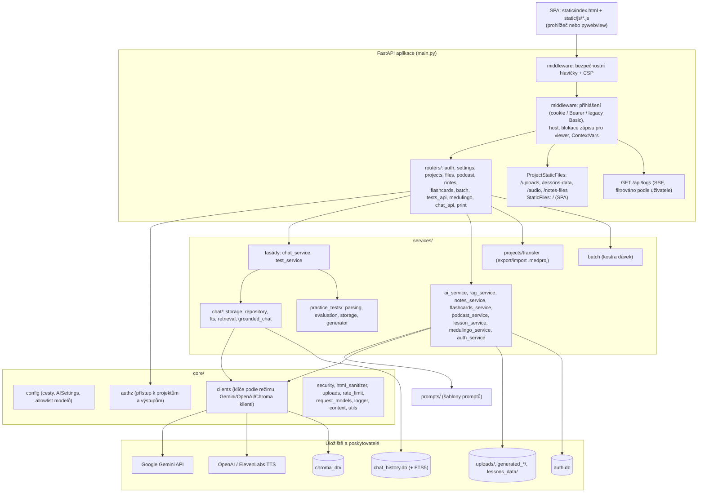

# AI MedStudio – Architektura systému

## 1. Přehled

AI MedStudio je studijní platforma pro medicínu. Skládá se z:

- **backendu ve FastAPI** (Python 3.11+, vývoj a testy na 3.14) s vrstvami `routers/` → `services/` → `core/`,
- **jednostránkového frontendu bez build kroku** (`static/index.html` + klasické skripty `static/js/*.js`),
- **lokálního úložiště**: SQLite (`auth.db`, `chat_history.db`), ChromaDB (vektory) a souborový systém (materiály a výstupy),
- **externích AI poskytovatelů**: Google Gemini (veškeré generování textu), OpenAI a ElevenLabs (TTS). Embeddingy pro vyhledávání počítá lokálně výchozí embeddingová funkce ChromaDB (model se stáhne při prvním použití).

Aplikace běží ve třech režimech: desktopové okno (`desktop_app.py`, pywebview + uvicorn ve vlákně), vývojový server (`uvicorn main:app`) a Docker server pro více uživatelů. Kdo vidí jaké projekty a čí API klíče se používají, určují **režimy sdílení** – viz [SECURITY.md](SECURITY.md).

---

## 2. Diagram



---

## 3. Vrstvy a moduly

### 3.1 `main.py` (orchestrace, ~255 ř.)
- Dva HTTP middleware:
  - **bezpečnostní hlavičky** včetně `Content-Security-Policy` (`core/security.py`);
  - **autentizace**: veřejné cesty (`/`, `/index.html`, `/health`, `/manifest.json`, ikony, `/css/*`, `/js/*`, `/static/*`, `/api/auth/{status,setup,login,register,logout}`) projdou bez přihlášení. Ostatní požadují relaci (HttpOnly cookie `medstudio_session` nebo `Authorization: Bearer`), případně legacy `APP_PASSWORD` (Basic, s rate limitem) nebo režim hosta. Pozorovateli blokuje zápisové metody. Nastaví `request.state.user`, `current_user_var` a `current_language_var`.
- `GET /api/logs`: SSE živý log, události filtruje `core.logger.can_receive_event`.
- Registrace 12 routerů a mountů. Soubory projektů jdou přes `ProjectStaticFiles` (kontrola přístupu k projektu u každého požadavku), SPA přes `StaticFiles(html=True)` na `/`.

### 3.2 HTTP vrstva (`routers/`)
Každá oblast má vlastní `APIRouter`. Těla JSON požadavků validují **Pydantic modely** odvozené od `core.request_models.RequestModel`:
- **strict**: hodnoty se nepřevádějí, špatný typ dává 422;
- pole přijímají `null`;
- neznámé klíče se ignorují.

Modely jsou definované přímo v routeru. Čtyři endpointy pracují záměrně s `dict`: uložení plánovače, nastavení, výsledku testu a otázek projektu.

| Router | Odpovědnost |
|---|---|
| `auth.py` | přihlášení, registrace, setup prvního admina (atomický), správa uživatelů a přepínačů |
| `settings.py` | API klíče (centrální / per-user BYOK), test klíče, otevření datové složky |
| `projects.py` | CRUD projektů, přejmenování, vyčištění dat, export/import, statistiky |
| `files.py` | upload (limity z `core/uploads.py`), náhledy, indexace do Chroma/FTS |
| `podcast.py`, `notes.py`, `flashcards.py` | generování scénářů, audia, titulků, studijních textů a kartiček |
| `batch.py` | dávky na pozadí (podcasty, texty, kartičky) nad `services/batch.py` |
| `tests_api.py` | cvičné testy, navazující otázky, výsledky, hodnocení otevřených odpovědí |
| `chat_api.py` | grounded chat (SSE), vlákna, plánovač a otázky projektu, výukové lekce |
| `medulingo.py` | studijní cesta po otázkách, balíček materiálů k otázce |
| `print.py` | tiskový náhled (sanitizované HTML, omezené úložiště úloh) |

Autorizace k projektům se volá v routerech (`require_project_access`, `require_output_file_access`, `require_thread_access` z `core/authz.py`).

### 3.3 Doménové služby (`services/`)
- **Fasády** `services/chat_service.py` a `services/test_service.py` jsou veřejné importní body balíčků `services/chat/` a `services/practice_tests/` (re-exporty se zachovanými jmény). Některé importy z `services.chat_service` jsou záměrně uvnitř funkcí, protože obcházejí cyklus `rag_service ↔ chat_service`.
- **`chat/`**:
  - `storage`: datová složka, SQLite připojení, schéma a migrace, `get_ai_client` a `get_chroma_client` delegované na `core.clients`;
  - `repository`: zprávy, vlákna, lekce, export a import SQLite dat;
  - `fts`: český FTS5 dotaz, indexace;
  - `retrieval`: hybridní vyhledávání Chroma + FTS;
  - `grounded_chat`: streamovaná odpověď.
- **`practice_tests/`**: parsování výstupu modelu, hodnocení otevřených odpovědí (lokální, bez AI), úložiště testů a generátor.
- **`projects/transfer.py`**: export a import projektu (`.medproj` / ZIP) s limity a novými ID při importu kopie.
- **`batch.py`**: `run_question_batch` – společná kostra dávek (3 pokusy, noční doplňovací kola, zrušení, dávkové události). Konkrétní režim dodá jen texty logů a funkci `produce`.
- **`ai_service.py`**:
  - `call_gemini_with_retries`: jazyková direktiva, retry s čekáním, fallback model, převod chyb;
  - `call_gemini_with_resilience`: vrací celou odpověď, používají ji lekce;
  - `get_fallback_model`, `clean_and_parse_json`.
- Ostatní: `rag_service` (extrakce, chunkování, indexace), `notes_service`, `flashcards_service`, `podcast_service` (TTS, SRT/MP4 přes FFmpeg), `lesson_service` (dvoufázová lekce: studijní text + přednáška; vlastní mapa záložních modelů), `medulingo_service`, `auth_service` (PBKDF2, relace, nastavení, vlastnictví projektů).

### 3.4 Jádro (`core/`)
| Modul | Obsah |
|---|---|
| `config.py` | detekce prostředí a datové složky (`AIMEDSTUDIO_DATA_DIR`), cesty, `ALLOWED_GEMINI_MODELS`, **`AISettings`** (`AI`): výchozí model, parametry generování podle úlohy, TTS modely, plány čekání, obě mapy záložních modelů |
| `clients.py` | výběr klíče podle režimu (sdílené / per-user BYOK), `require_allowed_model`, cache klientů Gemini, OpenAI a jediný `chromadb.PersistentClient` |
| `authz.py` | pravidla přístupu k projektům, výstupům a vláknům, `ProjectStaticFiles` |
| `security.py` | `safe_join`, `safe_filename` (path traversal), CSP |
| `html_sanitizer.py` | allowlist sanitizace HTML pro tisk |
| `uploads.py` | limity uploadu a importu (velikost, počet položek, kompresní poměr) |
| `rate_limit.py` | omezení neúspěšných přihlášení (podle uživatele+IP a IP) |
| `request_models.py` | základ Pydantic modelů těl požadavků |
| `logger.py` | SSE události, kruhový buffer, filtr příjemců, stav dávek (`active_batches`) |
| `context.py` | `ContextVar` pro uživatele a jazyk, jazyková direktiva promptů |
| `utils.py` | `sanitize_name`, chunkování textu, převod chyb API |

### 3.5 Prompty (`prompts/`)
Hlavní systémové instrukce jsou v `prompts/*.py` podle domény. Část pomocných instrukcí (například doplňující pokyny ve fázích lekce v `lesson_service.py`) je stále přímo v kódu služby.

### 3.6 Frontend (`static/`)
- `index.html` obsahuje kostru, modaly a načítá skripty **v pevném pořadí**:
  - `translations.js`;
  - `app.js` (jádro: globální stav, vyhledávání, filtry, tisk, záložky, dashboard, projekty, helpery `sendJson`, `showModal` a `hideModal`);
  - sekce `project-transfer`, `planner` (mj. `escapeHtml`, `escapeJsStringAttr`, `renderMarkdownSafe`), `questions-manager`, `materials`, `notes`, `flashcards`, `practice-tests`, `chat`, `viewer-navigation`, `lesson`, `podcast`, `settings`, `language`, `auth`, `medulingo`, `pomodoro`.
- Jde o **klasické skripty se sdíleným globálním scope** (ne ES moduly), protože ~313 inline handlerů (`onclick="fn(…)"`) volá globální funkce. Spojení skriptů v tomto pořadí odpovídá původnímu `app.js`. Inicializace běží v `DOMContentLoaded`. Při změně skriptu je potřeba zvýšit jeho `?v=` v `index.html`, aby se nový skript nepotkal se starým `app.js` z cache.
- Markdown z AI se vykresluje přes `marked` → **DOMPurify** → `innerHTML`. Hodnoty v HTML se escapují `escapeHtml`, v inline handlerech `escapeJsStringAttr`.
- Knihovny z CDN jsou pinnuté, se SRI (kromě Tailwind Play CDN).

### 3.7 Data
| Data | Umístění (relativně k datové složce) |
|---|---|
| uživatelé, relace, nastavení, vlastnictví projektů, per-user API klíče | `auth.db` |
| chat, vlákna, lekce, FTS5 index chunků | `chat_history.db` |
| vektory chunků (kolekce `proj_{projekt}`) | `chroma_db/` |
| nahrané materiály, plánovač projektu | `uploads/{projekt}/` |
| výstupy (prefix `{projekt}_`) | `generated_audio/`, `generated_notes/`, `generated_flashcards/`, `generated_tests/` |
| lekce | `lessons_data/` |
| centrální API klíče, globální nastavení | `user_config.json` |

Datová složka:
- zdrojové kódy: kořen repozitáře;
- zabalená aplikace: `~/Documents/AIMedStudio` (nebo přenosná složka `data/`);
- Docker: `/app/data`;
- `AIMEDSTUDIO_DATA_DIR` má přednost.

> Chat DB a Chroma používají ASCII ID projektu (`sanitize_project_name`), soubory používají `core.utils.sanitize_name`. U názvů s diakritikou se ID liší. Sjednocení by vyžadovalo migraci dat (nález R1).

---

## 4. Hlavní toky

- **Generování (např. poznámky):** router validuje tělo a přístup k projektu a ve sdíleném režimu klíčů i povolený model. Služba vyhledá kontext (`rag_service` / `chat.retrieval`), sestaví prompt a zavolá `call_gemini_with_retries` s parametry z `AI.*`. Výstup uloží jako `{projekt}_…` a průběh hlásí přes SSE log.
- **Dávky:** `routers/batch.py` založí `BatchState` v `active_batches` a spustí `run_question_batch` jako background task. Frontend sleduje dávkové události v `/api/logs`. Úklid stavu je bezpodmínečný, takže dávku jde po chybě hned spustit znovu.
- **Grounded chat:** `stream_grounded_chat` zajistí vlákno, vyhledá kontext (Chroma + FTS) a streamuje tokeny jako SSE (`sources`, `token`, `done` / `error`). Odpověď se ukládá do `chat_history.db`.
- **Klíče:** `core.clients.get_gemini_api_key` vybere klíč podle režimu sdílení (podrobnosti v [SECURITY.md](SECURITY.md)). Chat i lekce používají stejné pravidlo.

---

## 5. Testy

```bash
python -m unittest discover -s tests -t .
```

- **Izolace:** `tests/__init__.py` nastaví dočasnou datovou složku, prázdné API klíče a zablokuje síť. Každý testovací modul importuje `tests` jako první. Spuštění, které by načetlo konfiguraci dřív, se odmítne (`tests/test_isolation.py`).
- **Druhy testů** (22 testovacích modulů, 173 testů, z toho 6 opt-in smoke):
  - bezpečnost a autorizace (`test_project_authz`, `test_security*`, `test_auth_*`, `test_log_stream`, `test_print`, `test_import_upload`, `test_model_policy`, `test_byok_clients`);
  - CRUD endpointů (`test_routers_crud`);
  - charakterizační golden mastery (`test_services_characterization` + `tests/fixtures/services_golden.json`, `test_batch` + `batch_golden.json`; generují se jen záměrně přes `python -m tests.fixtures.generate_*`);
  - odolnost AI volání (`test_ai_resilience`);
  - modely požadavků (`test_request_models`);
  - integrita API (`test_api_integrity`: 79 cest, 91 operací).
- **Frontend smoke** (`AIMEDSTUDIO_FRONTEND_SMOKE=1`, Playwright + Chromium) ověřuje:
  - načtení bez chyb JS a existenci všech funkcí volaných z inline handlerů;
  - průchod sekcemi;
  - sanitizaci markdownu;
  - helpery `sendJson` a `showModal`/`hideModal`.
- AI volání v testech jdou přes falešného Gemini klienta (`tests/support.py`), embeddingy ChromaDB jsou deterministické a offline.

---

## 6. Známý architektonický dluh

Podrobnosti a stav jsou v [audit/AUDIT.md](audit/AUDIT.md) a [audit/CHANGELOG.md](audit/CHANGELOG.md).

- Frontend: globální scope a inline handlery (brání ES modulům a CSP bez `'unsafe-inline'`), `alert`/`confirm`/`prompt` místo jednotných dialogů, ~600 řádků češtiny mimo `translations.js`, dlouhé renderovací funkce (F8–F11).
- Dvě mapy záložních modelů s odlišným chováním (R3) a dvojí ID projektu v chat DB/Chroma vs. souborech (R1).
- Nekonzistentní deklarace verze Pythonu (R14). Neúplné `requirements.txt` (R13): chybí `pypdf`, serverový image instaluje i desktopové balíčky.
- Chybí CI (D5) a typová kontrola (D4).
